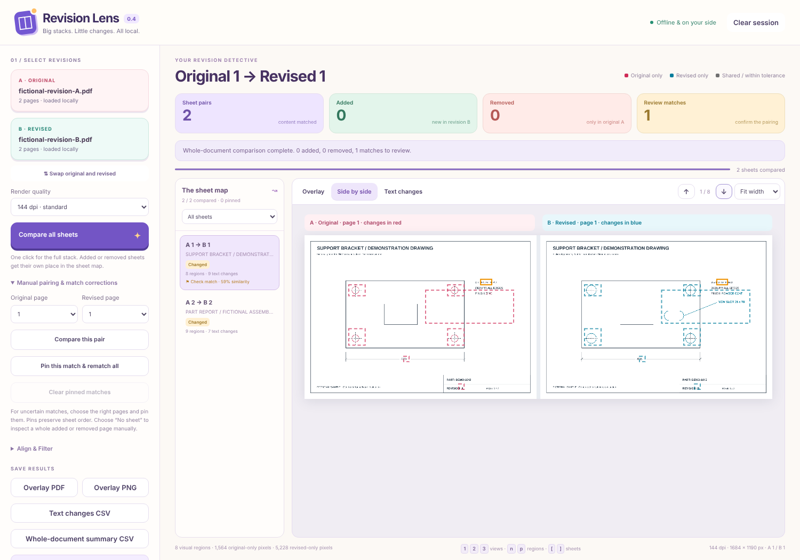

# Revision Lens

**Compare two PDF revisions on your own computer — including sheets that were added or removed.**

Revision Lens is a free, single-file browser app for reviewing drawing sets and part reports. Open two PDFs, compare the whole stack in one click, and follow the sheet map to every change. It works offline, with no installer, account or cloud service.

[Download the latest release](https://github.com/akapoor308/revision-lens/releases/latest) · [User guide](docs/USER-GUIDE.md) · [How it works](docs/ARCHITECTURE.md) · [Privacy](docs/PRIVACY.md)



## Start using it

1. Download and extract the release ZIP.
2. Open **Revision Lens.html** in a current desktop Chrome or Edge.
3. Drop your original and revised PDFs on the page — or click the two cards to choose them — then select **Compare all sheets**.
4. Click a row in **The sheet map**. Rows marked **Check match** are the ones worth a second look.

That is the whole workflow. You never select page numbers by hand, and you can disconnect from the internet first — the extracted app needs no network access at any point.

## What it does

| Feature | Behaviour |
|---|---|
| Whole-document comparison | Indexes and compares every sheet in both PDFs in one run. |
| Automatic page matching | Pairs sheets by their text, a visual fingerprint and document order, so an inserted sheet shifts the rest instead of misaligning everything. |
| Added and removed sheets | Get their own rows in the sheet map rather than being silently paired with something else. |
| Coloured overlay | Red marks original-only pixels, blue marks revised-only pixels, grey is shared content. |
| Side by side | The original exactly as it was drawn on the left; the revised sheet with its changes highlighted on the right. All change marking stays on the revised side. |
| Text changes | Lists added and removed extracted lines for the selected sheet pair. |
| Match corrections | Pin the correct pairing for an uncertain sheet and the whole stack is rematched around it. |
| Layer switches | Turn the original or the revised document off to study one on its own, in either view. |
| Full screen | Expand the viewer to the whole display, toolbar included. |
| Alignment and filters | Shift, rotate, scale, suggest a shift, tune sensitivity and ignore rectangles such as title blocks. |
| Exports | Overlay PDF and side-by-side PDF for one sheet, or a complete package PDF covering every sheet. |
| Fully offline | The PDF renderer, fonts, character maps and decoders are embedded in the one HTML file. |

For example, if a 19-sheet set gains a sheet at revised page 5, the map shows an added page 5, pairs original 5 with revised 6, and continues through original 19 → revised 20. Two documents with the same page count can still contain both an insertion and a deletion, and the map shows both.

## Three ways to look at a sheet

- **Overlay** — both revisions on one canvas, with nearby changed pixels grouped into numbered regions you can step through.
- **Side by side** — the original on the left, untouched, and the revised sheet on the right with its changes highlighted and boxed. Switch either document off to fill the width with the other.
- **Text changes** — added and removed extracted lines, with whitespace normalized.

Keyboard: <kbd>1</kbd> <kbd>2</kbd> <kbd>3</kbd> switch view, <kbd>n</kbd> and <kbd>p</kbd> step through change regions, <kbd>[</kbd> and <kbd>]</kbd> step through the sheet map, <kbd>f</kbd> toggles full screen.

## Privacy

Your PDFs are read into browser memory and never uploaded. The app has no upload endpoint, analytics, account system, browser storage or service worker. A Content Security Policy refuses every outbound connection, and the network APIs are replaced with functions that throw before any other code runs — in the page and in the PDF worker. See [Privacy](docs/PRIVACY.md).

## Good to know

Matching is a heuristic, and the app is honest about where it is unsure:

- Blank, repeated, reordered or heavily redrawn sheets can be ambiguous. Those rows are flagged **Check match**; pin the right pairing if the proposal is wrong.
- Moved sheets usually appear as one removal and one addition, because matching preserves page order.
- Similarity percentages are scores, not probabilities.
- Grayscale pixel comparison can miss a colour-only change of similar brightness. High tolerance, low render quality or a large ignored area can hide a small real change.
- Annotations, comments and interactive form fields are outside the comparison. No OCR, CAD entity recognition, table reconstruction, calibrated measurement or vector editing.
- Exported PDFs are rasterized images of what is on screen, not vector layers, and are not calibrated for measurement.
- Limits: 150 MB per PDF, 250,000 candidate page pairs per run, 12 megapixels per rendered sheet, 1,500 extracted text lines per sheet, 200 MB of image data per package export.
- A very large stack can make the browser tab unresponsive for a while. **Stop** takes effect between steps, not in the middle of a long render.

## Build and test

End users need nothing but a browser. For development, Node.js 24+:

```sh
npm ci --ignore-scripts --no-audit --no-fund
npm run build
npm test
```

The standalone app is written to `dist/Revision Lens.html`; a prebuilt copy is committed there too. For the offline browser suites:

```sh
npx playwright install chromium
npm run test:browser
npm run test:batch
```

Windows uses installed Chrome by default. Set `REVISION_LENS_BROWSER` to a Chromium or Edge executable to pick another browser. On Windows PowerShell, use `npm.cmd` if execution policy blocks `npm.ps1`.

See [Development](docs/DEVELOPMENT.md) and [Architecture](docs/ARCHITECTURE.md) for details.

## Repository layout

```text
source/             Application, comparison engine, matcher, HTML and CSS
dist/               Prebuilt standalone app and renderer license files
docs/               User guide, architecture and privacy notes
test-fixtures/      Invented PDFs used only by the automated tests
test-*.mjs          Pixel, matching and offline browser tests
build.mjs           Bundles renderer, worker and binary assets into the HTML
make_*.py           Optional fixture generators
licenses/           Third-party license copies
```

Found a problem? Open an issue with your browser and version, the settings you used and what you expected. Please attach only invented or redacted PDFs — never a confidential drawing.

## License

Application code is [MIT licensed](LICENSE). Bundled third-party components keep their own licenses; see [THIRD-PARTY-NOTICES.md](THIRD-PARTY-NOTICES.md) and `licenses/`. See [the changelog](CHANGELOG.md) for version history.
