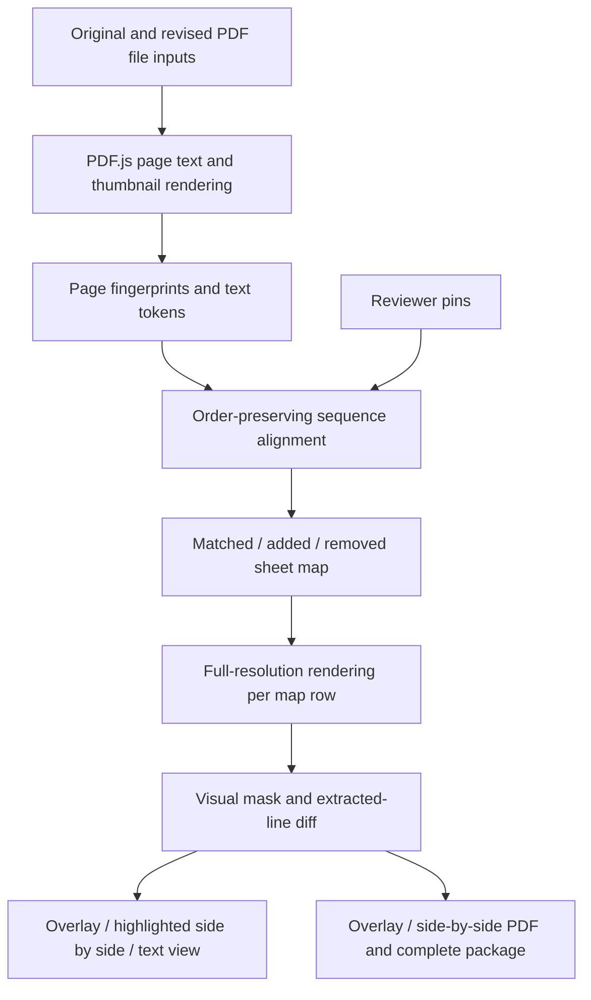

# How Revision Lens works

## Runtime boundary

The app is a standalone HTML file. `build.mjs` bundles the application with PDF.js, the PDF worker, fonts, character maps and decoder assets. A custom `EmbeddedBinaryDataFactory` supplies those bytes from the embedded asset map, and `useWorkerFetch` is false, so no asset load ever resolves to a URL.

The worker is bundled as a classic script and started from a Blob URL, one per document, and handed to PDF.js as an explicit `worker` port. This matters: Chrome refuses a *module* worker created from a blob URL on a `file://` page, and PDF.js responds by quietly parsing every page on the main thread instead. A classic blob worker loads, so parsing genuinely runs off the main thread. If a browser refuses blob workers altogether, `GlobalWorkerOptions.workerSrc` points at a small module wrapper that re-exports the same bundle, which keeps the main-thread fallback available. The browser test fails if the fallback is used.

There is no backend. File inputs and drops produce in-memory byte arrays; exports are Blob downloads. Test fixtures are never embedded or copied into the runtime build.

Two independent measures keep the page offline. The Content Security Policy sets `connect-src 'none'`, so the browser refuses outbound connections. An inline lock, the first script in the document, replaces `fetch`, `XMLHttpRequest`, `WebSocket`, `EventSource`, `RTCPeerConnection`, `SharedWorker` and `navigator.sendBeacon` with functions that throw; `build.mjs` prepends the same lock to the worker bundle, which has its own global scope. See [Privacy](PRIVACY.md).

## Page identity and similarity

`source/matching.mjs` handles pure matching logic; `indexDocument()` in `source/app.mjs` extracts features.

1. Render each page to a thumbnail no larger than 240 pixels on its longest side.
2. Crop the matching thumbnail to reduce page-edge counters/title-block influence. The crop starts at 5.5% X / 7.5% Y and covers 89% width / 81% height.
3. Resample the crop into a 24 × 24 grayscale-ink vector. This is a page-identity hint, not the change-detection resolution.
4. Extract text lines. For matching only, lowercase and normalize common page/sheet counters and revision labels; retain dimensions and part identifiers as tokens.
5. Weight tokens using their document frequency across both PDFs. Uncommon tokens contribute more than boilerplate. Text similarity is weighted Jaccard overlap; visual similarity is cosine similarity of the ink vectors. Token weights, per-page weight totals and vector norms are computed once up front, so scoring a page pair costs one pass over the smaller token set.
6. When both pages have at least five tokens, similarity is 68% text + 32% visual. Otherwise use visual similarity. Apply a page-aspect-ratio penalty.

These weights are heuristic and are not trained confidence probabilities. Rotated/scaled/shifted scans, repeated templates and substantial redraws can need manual review.

## Sequence alignment and inserted/removed sheets

`alignPageScores()` uses dynamic programming across the original/revised similarity matrix, up to the `MAX_PAGE_PAIRS` ceiling of 250,000 candidate pairs that the interface also enforces. A pair is eligible above a minimum similarity of 0.56. Matched pairs contribute their similarity minus that threshold; gaps represent unmatched sheets. The global alignment maximizes accumulated pair value while preserving order.

This avoids comparing only equal page numbers. An inserted revised page creates a gap on the original side, allowing all later correspondences to shift by one. The same logic supports deletion or insertion and deletion within equal-length documents.

Valid reviewer pins split the sequence into constrained segments; the pinned pairs anchor the surrounding alignment. Pins must be one-to-one and preserve order. Reordered sheets are not solved as arbitrary permutations and can appear as removals/additions.

Pairs are flagged if similarity is below 0.76 or an alternative is within 0.045 of their score. Unmatched pages with a plausible alternative are also flagged. Blank/near-blank pages are flagged regardless of high visual similarity. A reviewer pin confirms which sheets correspond; it says nothing about whether either sheet is correct. Pinning replaces any pin it conflicts with, rather than failing.

## Visual comparison

`comparePixels()` in `source/engine.mjs` compares full-resolution renders for a mapped row. An absent page is represented by white. Pages share a canvas large enough for both without automatic scale normalization. Manual transforms apply to revised page B around its centre.

Pixels are converted to grayscale ink. A configurable maximum-neighbourhood operation implements 0/1/2-pixel edge tolerance; because a square maximum filter is separable, it runs as one horizontal pass followed by one vertical pass rather than a full window per pixel. Ink differences beyond the chosen threshold become mask value 1 (original only) or 2 (revised only); excluded rectangles suppress visual changes there.

The overlay colours mask 1 red and mask 2 blue. Unchanged and within-tolerance content is grey. The side-by-side view draws the original render untouched on the left and, on the right, `highlightSide()` tinting only mask 2 onto the revised render — so the original sheet is never marked up, and all change annotation (region boxes, ignored-area rectangles) is drawn over the revised pane alone. Hiding a layer drops that pane and lets the other fill the width; in overlay view a single layer shows that document on its own.

Region boxes and ignored areas are amber throughout, leaving red and blue to mean original and revised content and nothing else.

Region grouping connects occupied 40-pixel tiles, retaining clusters with at least eight changed pixels. Region counts are navigation aids, not counts of real edits; the sheet map shows each changed row's region and text-change counts for the same reason. Smaller changed clusters can still contribute to pixel totals.

`suggestTranslation()` uses a downsampled distance-field search. It proposes translation only, with manual visual verification. It is not rotation/scale registration or CAD entity matching.

## Text comparison

Extracted items are assembled into lines using PDF text placement and end-of-line hints. Whitespace is normalized and an LCS-based line diff lists additions/removals. The limit is 1,500 lines per page. Reordered/reflowed tables are not interpreted as keyed rows; scanned/outlined text can yield no extracted lines.

Text comparison is independent of ignored rectangles and visual sensitivity. Matching normalization of counters/revision labels does not suppress their changes in the actual text/pixel comparisons.

## State, performance and export

Index features and map summaries are retained in memory. Detailed canvases are replaced and released between rows rather than caching full-resolution images for a whole stack, and each page's parser data is released once its comparison is done. Replacing one of the two files keeps the other document's index. Alignment, exclusions and settings are stored per mapped row. Stop requests are checked between steps; synchronous pixel work and long renders can delay them.

Exports compose each view explicitly rather than screenshotting the canvas, so a saved page never depends on the visible tab or the layer switches. `overlayBody()`, `splitBody()` and `textBodies()` build the image for one view; `withHeader()` adds the identification band; `packImagePages()` writes JPEG pages into a PDF with explicit page objects and cross-reference offsets. Text changes are wrapped and paginated onto sheet-sized pages. JPEG bytes come from `canvas.toBlob`, not a base64 data URL, so a large sheet is not held twice. Output is rasterized, the 200 MB image-data limit bounds the retained buffers, and no partial PDF is saved after stopping. The complete package rerenders every mapped row in turn using that row's saved settings.

For how your files are handled, see [Privacy](PRIVACY.md). For the day-to-day workflow, see the [user guide](USER-GUIDE.md).
